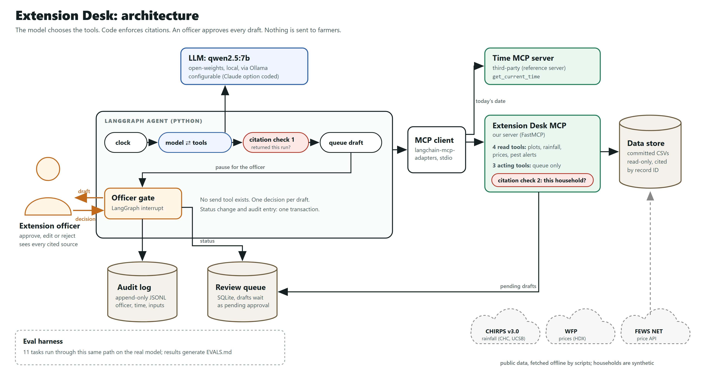

# Extension Desk

An agentic assistant for agricultural extension offices. An officer can't visit every smallholder, so Extension Desk turns rainfall, pest, price and plot data into **sourced advisory drafts**. A named officer reviews and approves each draft before anything reaches a household.

Built for the [Agentic AI for Africa Innovation Challenge](https://agentic-africa-challenge.lovable.app/tracks/agriculture), Agriculture track: "The Extension Backlog".

> **Status:** challenge submission, 15 Oct 2026. Results and known failures are in [EVALS.md](EVALS.md).

## How it works

- **The agent drafts and never sends.** It cannot message a farmer, place an input order or raise a credit flag. Every irreversible action stops at an officer approval gate. Each gate logs inputs, outputs, a timestamp and the approving officer.
- **Every recommendation is sourced.** Each line of advice cites the rainfall, price or plot record it relies on. A recommendation with no source is rejected before an officer ever sees it.
- **Built on MCP.** Our own MCP server exposes the data and drafting tools, and the agent also uses one third-party MCP server (see [ARCHITECTURE.md](ARCHITECTURE.md)).
- **Open source throughout.** Orchestration uses LangGraph, and at least one full task runs on an open-weights model.

## Who it's for

Agricultural extension officers, who advise far more smallholder households than they can visit, and the households they serve. The pilot districts are Chiredzi (Masvingo) and Mangwe (Matabeleland South) in Zimbabwe, where rain-fed maize and sorghum farming makes the start-of-season decisions the costly ones.

## Architecture



- **Agent (LangGraph):** one household per run. The steps are: clock (today's date from the time MCP server), then the model and its read tools in a loop the model controls, then a citation check, a queued draft, and the officer gate (a LangGraph `interrupt`). A failed check gets one retry; then the draft is dropped and logged. Limits: 10 model turns and 2 failed drafts. State lives in LangGraph's in-memory checkpointer, on a fresh thread per run; there's no long-term memory.
- **Model:** `qwen2.5:7b` (open-weights) through Ollama, temperature 0, 16k context. It's configurable with `EXTENSION_DESK_MODEL`. An Anthropic Claude option is coded but hasn't been run yet (#14).
- **MCP:** two servers over stdio, through `langchain-mcp-adapters`.
  - **Extension Desk MCP server** (ours, FastMCP), runnable on its own with `uv run extension-desk-mcp`. It has four read tools (`get_plot_records`, `get_rainfall`, `get_prices`, `get_pest_alerts`), each returning records plus their citation IDs. It has three acting tools (`draft_advisory`, `flag_for_followup`, `schedule_followup`), which can only add items to the officer review queue as `pending_approval`. Before writing, the server checks that every citation exists, belongs to this household or its district, and, for pest alerts, concerns a crop the household grows.
  - **Reference time MCP server** (`mcp-server-time`, third-party): `get_current_time` in Africa/Harare.
- **Human in the loop:** the officer sees each draft with every cited record and its source, then approves, edits or rejects it, under their own name. The status change and the audit entry are written in one SQLite transaction. No tool can send, approve or order anything.
- **Storage:** an SQLite review queue, an append-only JSONL audit log, and per-run transcripts. Source data is committed CSVs; see [Data](#data).

More detail is in [ARCHITECTURE.md](ARCHITECTURE.md).

**Stack:** Python 3.11+, uv, LangGraph, LangChain, langchain-mcp-adapters, the official MCP Python SDK (FastMCP), mcp-server-time, Ollama, Pydantic, SQLite, pytest (`uv run pytest`, 138 tests) and GitHub Actions CI.

## Run it

```bash
uv run extension-desk demo
```

This runs one backlog pass over the Chiredzi pilot district. For each of three households, the agent gathers evidence through our MCP server, drafts an advisory with citations, and stops at the officer approval gate. Each tool call the model makes is printed as it happens, with what came back and what the citation checks decided (`--quiet` turns this off). You answer as the officer (approve, edit or reject). Nothing is sent to any household. Decisions go to `state/audit.jsonl`, and a full transcript of the run to `state/runs/`.

Before you run it:

- [uv](https://docs.astral.sh/uv/)
- [Ollama](https://ollama.com) with the default open-weights model: `ollama pull qwen2.5:7b`. If Ollama isn't running, the demo says so and exits.

Options: `--quiet`, `--district mangwe`, `--limit N`, `--officer NAME`, `--decide approve|reject` (non-interactive), `--model anthropic:<model>` (hosted; run `uv sync --extra hosted` and set `ANTHROPIC_API_KEY`).

## Evals

```bash
uv run extension-desk eval                 # 11 tasks on the configured model, about 15 minutes on a laptop GPU
uv run extension-desk eval --update-evals  # also rewrite the results table in EVALS.md
```

Each task runs the real agent and MCP servers, often on a modified copy of the data (a drought, missing records, a hostile data field), and checks the outcome automatically. Results and transcripts go to `evals/results/`. See [EVALS.md](EVALS.md) for the latest run and the known failures.

## Limitations

- **Prompt injection isn't fixed.** An instruction hidden in a data record can reach the officer as a cited recommendation; only the officer gate stops it. The full write-up is in [EVALS.md](EVALS.md).
- **The citation checks prove relevance, not support.** They prove a cited record is about the household. They don't prove the advice follows from that record.
- **Small-model errors.** On `qwen2.5:7b` the agent scores 6 to 8 of 11 evals across its last four runs, and sometimes resubmits a citation that was already refused.
- **No hosted-model comparison yet** (#14).
- **Pilot scope.** Two districts, one rainfall pixel per district, some proxy markets, and synthetic households. The officer interface is a terminal program.

## Future improvements

- Screen and mark untrusted text in data fields, and check key terms against the cited record (the next steps for the injection failure).
- Strip refused citations before a retry, so a usable draft isn't lost.
- Run the hosted-model comparison.
- Build an officer-friendly interface, and pilot with real extension offices under proper data consent.

## Data

See [data/README.md](data/README.md) for every source, what it covers, and what it doesn't. No real household records are used. Household and plot data is synthetic.

## Docs

- [ARCHITECTURE.md](ARCHITECTURE.md): one-page design
- [EVALS.md](EVALS.md): test tasks, pass/fail results, and known failures

## Licence

Apache-2.0
